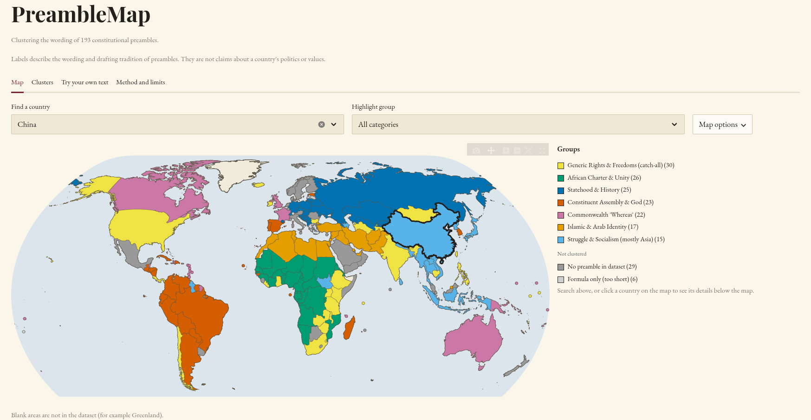

# PreambleMap: Clustering Constitutional Preambles by Their Wording

An NLP project that groups the preambles of 158 national constitutions by how they are written, and shows the result on an interactive world map.



**Live app:** [https://preamblemap.streamlit.app/](https://preamblemap.streamlit.app/)

> **Read this first.** The groups describe the wording and drafting tradition of preambles. They are not claims about any country's politics, ideology or quality of governance, and the structure found is weak (see Findings). Whether a country is coloured, grey or blank on the map is a statement about the dataset, not about the country.

## What this project does

1. Audits a dataset of constitution texts and extracts the actual preamble from each one.
2. Turns each preamble into a sentence embedding (`all-mpnet-base-v2`), with the country's own name masked.
3. Clusters the embeddings into 7 groups with a consensus of 200 KMeans runs.
4. Tests how stable and how meaningful the groups are, and labels them from their keywords.
5. Serves everything in a Streamlit app: a world map, a cluster browser, and a tool that classifies any pasted preamble.

## Results at a glance

- 193 countries are in the dataset. 158 are clustered, 29 have no preamble in the dataset (the pasted text was the body of the constitution), and 6 have only an enacting formula.
- The structure is real but weak. The cosine silhouette is at most 0.16. The groups beat a Gaussian null of the same shape for every k from 3 to 12, but HDBSCAN finds only 2 or 3 clusters and leaves many countries unassigned. The groups are soft, not natural categories.
- A single KMeans run is unstable (agreement between seeds, ARI, is 0.56 to 0.71 at k = 7), so the labels come from a consensus over 200 runs.
- The groups follow drafting tradition and region more than ideology.
- Of the seven group labels, one rates strong, six rate moderate and none weak by a rule fixed before testing. Three groups are marked loosely defined.

## The seven groups

| Group | Countries | Rating | Cohesion | What defines it |
|---|---|---|---|---|
| Generic Rights & Freedoms (catch-all) | 30 | moderate | loosely defined | Short, generic rights and freedoms wording (median 114 words). Precision is only 19%, so it works as a catch-all. Only 35% of "We the people" openers land here. |
| African Charter & Unity | 26 | moderate | well-defined | All 26 are in Africa. Preambles cite the African Charter, the Universal Declaration and the "rights of man", and stress national and African unity. |
| Statehood & History | 25 | moderate | well-defined | Statehood and history language ("statehood" appears in 48% of members vs 2% elsewhere). Central and Eastern Europe, the former USSR, plus Germany, Switzerland and Andorra. |
| Constituent Assembly & God | 23 | moderate | well-defined | A constituent assembly acting under God ("invoking" in 43% vs 4%). Mostly Ibero-American countries, Spain, Portugal and Lusophone Africa (19 of 23). The other four are Estonia, Madagascar, South Korea and Suriname. |
| Commonwealth 'Whereas' | 22 | moderate | loosely defined | "Whereas" drafting (12 of 22 open with it). Six members use none of the group's vocabulary: France, the United Kingdom, Comoros, Marshall Islands, Micronesia and Solomon Islands. |
| Islamic & Arab Identity | 17 | strong | well-defined | Islamic and Arab identity ("merciful" in 59% vs 0%). Coverage 94%, precision 89%. |
| Struggle & Socialism (mostly Asia) | 15 | moderate | loosely defined | Struggle and socialist language ("socialist" in 47% vs 4%, "struggle" in 53% vs 15%). Mostly Asia. Japan and South Sudan sit on the boundary. |

**How labels were rated.** The rule was fixed before the test: strong if coverage is at least 60% and precision at least 50%; weak if coverage is below 40%; otherwise moderate. Coverage was partly circular (the test patterns came from each group's own keywords), so precision is the more informative number. "Loosely defined" marks the three groups with the lowest silhouette and the lowest subsample confidence.

## The data audit

The first version of this project clustered a column called "Preamble" and produced seven groups. An audit showed the column mixed document types:

- 33 of 193 texts were longer than 5,000 words (full constitutions pasted in), 41 were longer than 1,000 words, and the median was 255 words.
- Slovakia had no text because of a name mismatch ("Slovak Republic" vs "Slovakia"), and Cyprus appeared twice.
- The embedding model truncates at 384 tokens, and 43% of the raw texts were longer than that.
- Some text had broken HTML entities (`x27;`, `quot;`, `nbsp;`).
- All 27 body-text countries sat in just three of the seven original clusters, so the first clustering was partly separating "body text" from "preamble".

The project was rebuilt on extracted preambles only:

| Status | Countries | Notes |
|---|---|---|
| Clustered | 158 | 149 clean preambles plus 9 that were cut at the end of the preamble (France, Libya, Palestine, Slovakia, Suriname, Cuba, Australia, Canada, Lebanon) |
| No preamble in dataset | 29 | The pasted text is the constitution body. The real constitution may still have a preamble (for example Qatar, Somalia). |
| Formula only | 6 | Belgium, Greece, Latvia, Liechtenstein, Tonga, Jordan |

Two provenance caveats are shown in the app: the United Kingdom text is Magna Carta, and the Russia text refers to the Third All-Russian Congress of Soviets (an early Soviet-era text). Neither is a current constitutional preamble.

## Method

1. **Embeddings.** `all-mpnet-base-v2`. Each text is split into chunks of at most 300 tokens, the chunk vectors are averaged (weighted by token count) and normalised.
2. **Masking.** The country's own name is replaced by `[COUNTRY]`, so a country is not grouped because it names itself. Demonyms and words like "African" or "Arab" are not masked, so region partly shows through.
3. **Centring.** The column mean is subtracted and the vectors are normalised again. This raised seed stability by 0.10 to 0.12 ARI and subsample stability by 0.06 to 0.18 at k = 7.
4. **Clustering.** KMeans with k = 7, run 200 times. A co-association matrix and average-linkage clustering turn the runs into one consensus. A refinement pass moved 3 countries (Algeria, Ethiopia, Marshall Islands). Groups are numbered by size.
5. **Choice of k.** k = 7 is where the silhouette peaks for the chosen representation and is the most subsample-stable of 5, 7 and 9. This is weak evidence, so 7 is described as a defensible resolution, not the true number of groups. A Gaussian mixture's BIC is lowest at 8 and nearly flat from 7 to 10.
6. **Labels.** Each group is described by distinctive terms and bigrams, its most central countries, and a validation test (coverage and precision of keyword patterns).

Six representations (raw, cleaned, masked, and their centred versions) were compared. The masked, centred version was chosen on method, not on best score.

## Findings

- **Weak but real structure.** Overall silhouette of the final labels is 0.1606. All six representations beat the Gaussian null for k = 3 to 12.
- **Stability.** Split-half agreement of the consensus is 0.955 (ARI). Subsample consensus agrees with the final labels at ARI 0.89.
- **Other algorithms.** Gaussian mixtures agree with the consensus at ARI 0.78 (spherical) and 0.82 (diagonal). Ward linkage gives 0.54, average-linkage cosine 0.58.
- **Other embeddings.** TF-IDF with SVD (silhouette 0.10, seed stability 0.36) and all-MiniLM-L6-v2 (silhouette 0.12, seed stability 0.55) are less stable than `all-mpnet-base-v2`.
- **Borderline countries.** 14 are flagged (low subsample confidence, or a runner-up cluster scoring above their own). Only 4 of 158 have a negative silhouette: Cambodia, Ethiopia, Saint Lucia and South Sudan.
- **Drafting tradition.** 12 of the 18 "Whereas" openers are in Commonwealth 'Whereas', and 10 of the 16 "In the name of" openers are in Islamic & Arab Identity. But only 22 of the 62 "We the people" openers are in the catch-all group. Cramer's V between group and opening formula is 0.50.
- **Region explains less than half.** Against continent, ARI is 0.30 and NMI 0.45. Predicting a group from the other countries on the same continent is right 45.8% of the time, against 19.4% for always guessing the largest group. Africa splits over 6 groups and Asia over 5.
- **Length.** Group and length are related (Kruskal-Wallis p below 1e-5) but weakly (ARI with length terciles 0.04 to 0.08). A first-chunk-only variant keeps 14 of 16 members of the longest-text group together, so that group is not just an averaging artefact.
- **A consistency check, not accuracy.** Assigning each country to its nearest group centre reproduces the stored label for 155 of 158 countries (98.1%). This is expected because the groups were found in the same space, so it is shown only as a consistency check.
- **Untested hypothesis.** The 11 African countries in the catch-all group look mostly English-speaking. There is no legal-origin variable in the data to test this.

## Limitations

- The structure is weak (silhouette at most 0.16). Groups are soft groupings, not natural categories.
- Groups reflect preamble wording, not how a country is governed. Many texts are English translations.
- Region words and demonyms are not masked, so region partly shows through.
- 29 countries have no preamble in the dataset even though their real constitution may have one, and 6 have only an enacting formula. Palau and San Marino are not in the dataset at all. Northern Cyprus and Somaliland draw blank because Natural Earth lists them separately.
- The United Kingdom and Russia texts are not current constitutional preambles.
- The label coverage test was partly circular, and the rating rule is a crude screen.
- "Try your own text" is indicative only. Short, generic or non-constitutional text lands in the catch-all group more often.
- The classifier needs about 0.9 GB of memory at peak (0.8 to 1.1 GB across test runs) and downloads a 420 MB model on first use.

## Using the app

| Tab | What it shows |
|---|---|
| Map | World map coloured by group. Search for a country or click it to see its group, how firmly it fits, its next closest group, how it opens, and its five most similar preambles. "Highlight group" dims all other groups. |
| Clusters | One panel per group with distinctive terms, bigrams, central and borderline countries, and every member with its fit score. |
| Try your own text | Paste a preamble to see which group centre it is closest to and which preambles it resembles. |
| Method and limits | How the groups were built and what they do and do not show. |

## Run it locally

Requires Python 3.12.

```bash
git clone https://github.com/devpanchal2005/PreambleMap.git
cd PreambleMap
python3.12 -m venv venv
source venv/bin/activate
pip install -r requirements.txt
streamlit run app.py
```

`requirements.txt` installs the CPU build of PyTorch. If your host or pip rejects the extra-index line at the top of the file, remove it (the install then downloads a much larger PyTorch build).

The first click on "Classify" downloads the embedding model (about 420 MB). To switch the classifier off, for example on a host with little memory, set the environment variable `PREAMBLEMAP_CLASSIFY=false` (or add it as a Streamlit secret). Everything except the "Try your own text" tab keeps working, and PyTorch is never loaded.

## Reproduce the analysis

```bash
pip install -r requirements-dev.txt
```

Then open the notebooks in `notebooks/` with the venv as the kernel and run them in order. See [notebooks/README.md](notebooks/README.md) for what each one does. The saved notebook outputs already contain the results. Column meanings for every data file are in [docs/data_dictionary.md](docs/data_dictionary.md).

## Repository structure

```
app.py                       Streamlit app
src/preamble_model.py        embedding, masking and classification functions
src/map_view.py              map figure, legend and country card
notebooks/                   the analysis, in order (see notebooks/README.md)
data/raw/                    original constitution dataset
data/processed/              audit, extraction, clustering and validation outputs
data/app/                    the data package the app reads
data/external/               Natural Earth country shapes
docs/                        screenshot, data dictionary, viva notes
.streamlit/config.toml       app theme
requirements.txt             runtime dependencies
requirements-dev.txt         runtime plus notebook dependencies
```

## Data sources and licences

- **Constitution texts:** the Comparative Constitutions Project (Zachary Elkins, Tom Ginsburg and James Melton), as distributed through Constitute (constituteproject.org). Constitute states that its content is provided under a Creative Commons Attribution-NonCommercial 3.0 licence; earlier announcements described an Attribution-ShareAlike licence. This project is non-commercial and educational. Anyone reusing the texts should check the current terms.
- **Country shapes:** Natural Earth 1:50m admin-0 countries, public domain. Country names are joined to the shapes with a small alias table (for example "Marshall Is." for Marshall Islands).
- **Embedding model:** `sentence-transformers/all-mpnet-base-v2`, Apache-2.0 licence.

## A note on the map

The map shows what the dataset contains. Grey means the dataset text has no preamble or only a short enacting formula. Blank means the country or territory is not in the dataset. Borders and names follow Natural Earth, and nothing here is a position on any territorial or political question.

## Future work

- **Formula-stripped robustness check.** Remove the opening formulas ("We the people of...", "Whereas", "In the name of God...") from every text, re-embed, repeat the consensus and compare the groups with the current ones. This answers whether the groups are mostly boilerplate. The opening-formula results above suggest they partly are.
- **Test the hypotheses.** Add external variables such as legal origin and colonial heritage, and see whether they explain the groups better than region does.
- **Separate tradition from region.** Mask demonyms and regional words and check which groups survive.
- **Change over time.** Compare group membership with the year each constitution was adopted.
- **Softer views of the structure.** Soft clustering, or a UMAP projection, to show the overlap between groups directly.
- **Better data.** Replace the United Kingdom and Russia texts with current preambles, check the 29 no-preamble countries against the real constitutions, add Palau and San Marino, and use original-language texts instead of English translations.
- **Human validation.** Ask readers with constitutional-law knowledge to judge the group labels.
- **A better classifier.** Test it on held-out real preambles instead of showing similarity only.

## Acknowledgements

Comparative Constitutions Project and Constitute for the texts, Natural Earth for the shapes, the Sentence-Transformers team for the embedding model, and the Streamlit and Plotly teams for the app tools.
